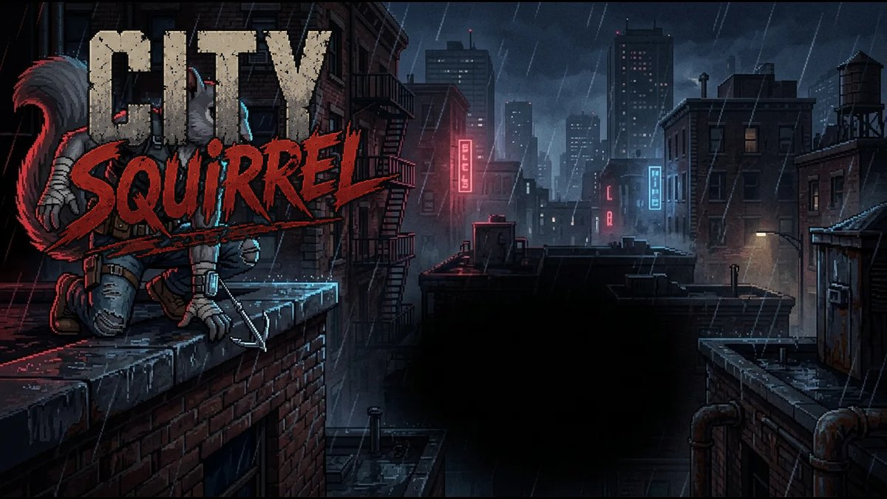

# City Squirrel: East End

A noir 2.5D beat-'em-up that runs in the browser. One squirrel with a grappling hook takes on the East End Syndicate across ten districts.

**▶ Play:** https://etothesmith.github.io/city-squirrel/

## Features
- Belt-scroller brawling with four-layer parallax and arena lock-ins that open into 3D rooms
- Combos, counters, disarms, weapon throws and finishers
- Grappling hook: yank thugs, zip to heavies, pull crates, ride car roofs
- Rooftop detours in every level: swing across gaps, chain swings mid-air, grab ledges, knock thugs off the edge — and dodge wind gusts, rotten roofs, steam vents and a sniper's searchlight (girders and catwalks on the indoor levels)
- Enemies arrive in readable waves: telegraphed entrances, a cap on how many fight at once, and only a few attack at a time
- Flying Squirrel power-up: glide, ride vents, dive-bomb
- Ten districts and ten bosses, a Street Cred rank system and an Acorn Stash for upgrades
- Keyboard, gamepad and touch controls; progress saves in your browser

## Controls
| Action | Keys |
|---|---|
| Move | WASD / arrow keys |
| Jump / glide | Space |
| Attack | J or Z |
| Heavy / counter | K or X |
| Grapple | L or C |
| Dodge | Shift or V |
| Pick up / throw | E / Q |
| Bio-Surge special | F or B |
| Pause / mute | Esc / M |

## Files
- `index.html`: landing page
- `play.html`: the whole game in one self-contained file (art and audio embedded)
- `assets/`: images for the landing page

All characters, art and story are original.
